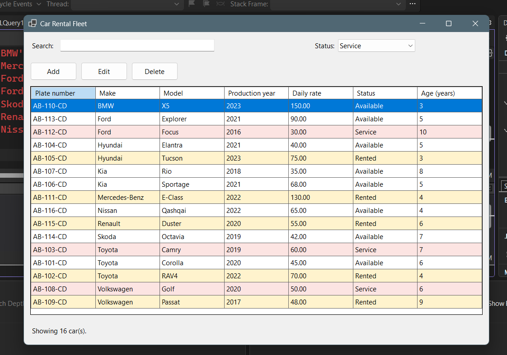
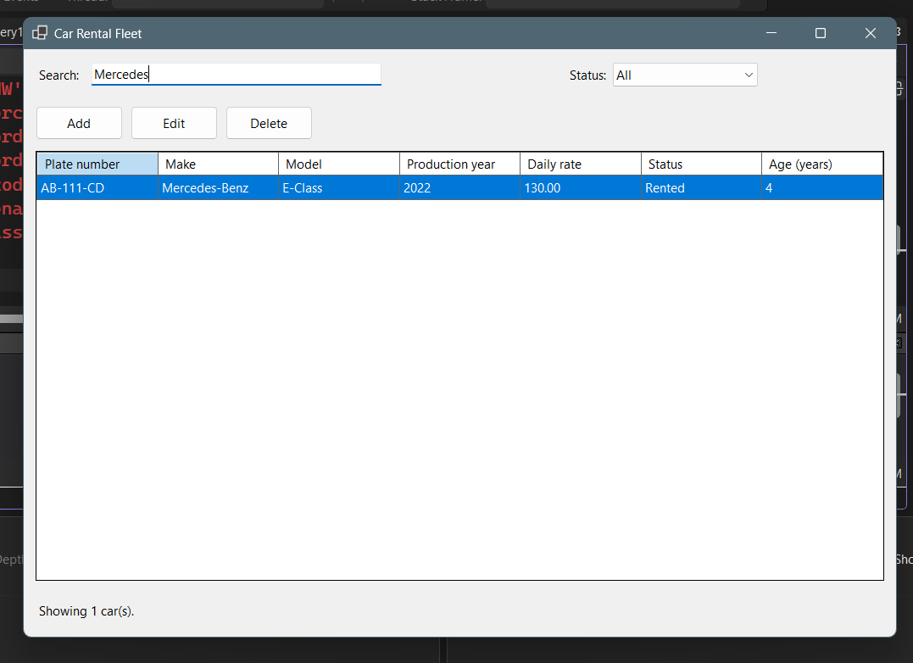
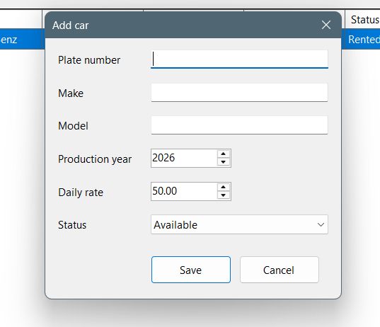
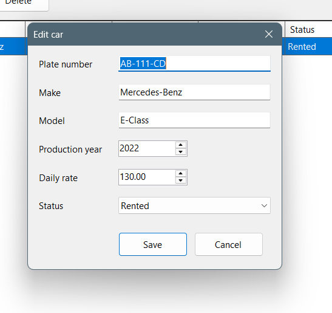

# Car Rental Fleet

A Windows Forms desktop application for managing the cars of a small car rental fleet. It lists every vehicle in a grid, lets you search by plate number or make, filter by status, and add, edit or delete cars. All data is stored in a SQL Server LocalDB database, and the database is created and filled automatically from a single SQL script.

The project was built as a university midterm project for Object-Oriented Programming in C#, and is structured as a small but complete three-layer application: a user interface, a data-access repository, and a model class.

## Features

- **List**: every car in the fleet is shown in a sortable grid with readable column headers.
- **Search**: type part of a plate number or make to narrow the list. Results update as you type.
- **Filter**: choose a status (All, Available, Rented or Service) to show only matching cars. Search and filter work together.
- **Add**: open the dialog, enter the details of a new car and save it.
- **Edit**: double-click a row, or select a row and press Edit, to change an existing car.
- **Delete**: select a car and press Delete. The application asks for confirmation before anything is removed.
- **Input validation**: required fields, value ranges and business rules are checked before any data reaches the database.
- **Visual status cues**: cars on service are highlighted in red, and cars currently rented are highlighted in amber.
- **Calculated age**: the grid shows the age of each car in years, calculated from its production year.

## Technologies

- C# and .NET (Windows Forms)
- Microsoft SQL Server LocalDB
- Microsoft.Data.SqlClient, with parameterised SQL commands
- Visual Studio 2026

## Database

The database is named `CarRentalFleetDb` and contains a single table, `Cars`.

| Column           | Type          | Notes                                              |
|------------------|---------------|----------------------------------------------------|
| `Id`             | INT           | Primary key, identity (auto-increment)             |
| `PlateNumber`    | NVARCHAR(15)  | Required, unique                                   |
| `Make`           | NVARCHAR(50)  | Required, searchable                               |
| `Model`          | NVARCHAR(50)  | Required                                           |
| `ProductionYear` | INT           | Required                                           |
| `DailyRate`      | DECIMAL(8,2)  | Required                                           |
| `Status`         | NVARCHAR(20)  | Required; one of `Available`, `Rented`, `Service`  |

The script `database.sql` creates the database and table if they do not already exist, and inserts 16 sample cars if the table is empty. It is safe to run more than once.

## Project structure

```
CarRentalFleet.slnx        Visual Studio solution file
CarRentalFleet.csproj      Project file
Program.cs                 Application entry point
Forms/
  MainForm.cs              Main window: the list, search, filter and buttons
  MainForm.Designer.cs     Layout of the main window
  MainForm.resx            Resources for the main window
  CarForm.cs               Add/Edit dialog and its input checks
  CarForm.Designer.cs      Layout of the Add/Edit dialog
Models/
  Car.cs                   The Car model (one row of the Cars table)
Data/
  CarRepository.cs         All SQL code, the only place that talks to the database
  database.sql             Creates the database, the table and the sample data
screenshots/               Screenshots of the application
```

The user interface never contains SQL. Every database call goes through `CarRepository`, which uses parameters for all values, so user input is never inserted into the SQL text.

## Requirements

- Windows 10 or Windows 11
- Visual Studio 2026 with the **.NET desktop development** workload
- SQL Server LocalDB (installed with Visual Studio's **Data storage and processing** workload)

## Getting started

1. **Create the database.** In Visual Studio, open **View → SQL Server Object Explorer**.
2. Right-click `(localdb)\MSSQLLocalDB` and choose **New Query**.
3. Open `Data/database.sql`, or paste its contents into the query window, and press **Execute**. The messages pane should report that the 16 sample rows were inserted.
4. **Open the solution.** Open `CarRentalFleet.slnx` from this folder in Visual Studio.
5. **Build the project.** Choose **Build → Rebuild Solution**. The build should finish with 0 errors.
6. **Run the application.** Press **F5**.

If you run `database.sql` again later, it will not add the sample rows a second time. To start from a clean database, delete `CarRentalFleetDb` in SQL Server Object Explorer, then run the script again.

## Using the application

- **Searching:** type in the **Search** box. The grid searches both the plate number and the make, and an empty box shows every car.
- **Filtering:** use the **Status** drop-down to show only cars with one status. It works together with the search box.
- **Adding a car:** press **Add**, fill in the form and press **Save**. Press **Cancel** or Esc to leave without saving.
- **Editing a car:** double-click a row, or select it and press **Edit**.
- **Deleting a car:** select a row, press **Delete** and confirm.

The status bar at the bottom of the window reports each action, for example "Car added.", "Car updated." or "Car deleted.". It also says when a search or filter finds no matching cars.

## Validation rules

When you save a car, the form checks that:

- the plate number, make and model are not empty;
- the plate number has at least 6 characters, for example `AB-101-CD`;
- the production year is between 1980 and 2100, and is not more than one year in the future;
- the daily rate is between 1 and 5000;
- a status has been chosen.

If a check fails, a message explains what is wrong, and the form stays open with your input, so you can correct it. A plate number that is already in the database is also rejected.

## Screenshots

| Main window | Search result |
|---|---|
|  |  |

| Add dialog | Edit dialog |
|---|---|
|  |  |
